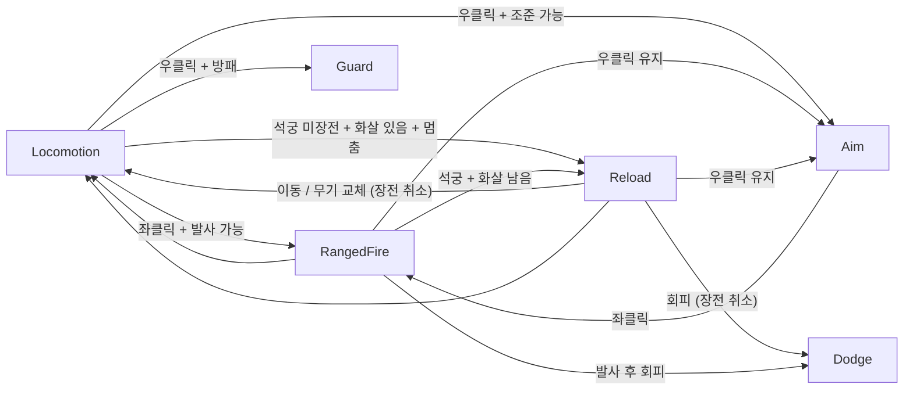

# Ranged Combat

## 개요
활·석궁의 조준, 발사, 화살 소모, 석궁 장전과 범용 투사체(포물선 비행, 명중 시 피해 + 박힘/소멸, 풀링), 조준 모드 숄더뷰·경로 미리보기. 투사체는 마법탄([Magic](Magic.md))과 공용.

## 조작
| 무기 | 좌클릭 | 우클릭 (홀드) |
|---|---|---|
| 활 (양손) | 발사 (비조준 시 짧게 당기기 → 쏘기) | 조준 모드 (오래 당길수록 강하고 멀리) |
| 양손 석궁 | 발사 | 조준 모드 |
| 한손 석궁 | 발사 | 방패가 있으면 가드 (조준 모드 없음) |

- **발사 조건**: 활은 화살 1개 이상, 석궁은 장전 완료.
- **석궁 장전**: 발사 후 화살이 남아 있으면 자동 Reload, 미장전 석궁을 들고 **멈춰 있으면** 자동 Reload. 장전 중 이동·회피·무기 교체로 끊을 수 있고, 끊기면 장전되지 않는다. 장전 부담만큼 석궁 데미지가 활보다 높다.
- **활 당기기**: 조준 모드에서 당긴 시간(`drawDuration`까지)에 비례해 화살 속도(사거리)와 데미지가 오른다. 조준점 아래 게이지로 표시.
- **조준 모드**: 숄더뷰 + 조준점 + 경로 미리보기, 캐릭터는 조준 지점을 바라보며 느리게 스트레이프 이동.
- **비조준 발사**: 화면 중앙의 작은 점 방향으로 발사.
- **착탄 마커**: 조준 모드에서 경로선 끝(실제 떨어지는 곳)에 원형 마커.

## 구성 스크립트
| 파일 | 책임 |
|---|---|
| [RangedWeaponData.cs](../../Assets/Project/Scripts/Weapon/Data/RangedWeaponData.cs) | 화살 종류, 조준·장전 여부, 발사 지점·속도, 당기기(시간·속도·데미지 배율, `WindupDrawRatio`), windup/fire/aim/reload 모션·타이밍, 조준 자세 고정, 장전 볼트 위치 |
| [AmmoData.cs](../../Assets/Project/Scripts/Weapon/Data/AmmoData.cs) | 화살 모델(시위 표시), 투사체 프리팹, 중력, 수명, 박힘 시간, 명중 이펙트 → `ToProfile()` |
| [Inventory.cs](../../Assets/Project/Scripts/InventorySystem/Inventory.cs) | 화살 보유 수 = 가방의 화살 수량 (`GetCount` / `TryConsume`, [Inventory](Inventory.md)) |
| [PlayerRangedWeapon.cs](../../Assets/Project/Scripts/Player/PlayerRangedWeapon.cs) | 발사/조준/장전 가능 여부, 화살 소모, 석궁별 장전 상태, 투사체 설정 조합 |
| [PlayerAmmoVisual.cs](../../Assets/Project/Scripts/Player/PlayerAmmoVisual.cs) | 활 시위 화살(오른손), 석궁 장전 볼트 표시 |
| [PlayerAimPresenter.cs](../../Assets/Project/Scripts/Player/PlayerAimPresenter.cs) | 조준 상태 → 카메라 숄더뷰·조준점 전환, 조준 중 당김 게이지 갱신 |
| [RangedDraw.cs](../../Assets/Project/Scripts/Player/RangedDraw.cs) | 활 당김 비율(일반 클래스, `PlayerController.Draw`): 조준 중 누적, 발사 시 리셋 |
| [States/](../../Assets/Project/Scripts/Player/States/) | `PlayerAimState`, `PlayerRangedFireState`, `PlayerReloadState` |
| [RangedAttacker.cs](../../Assets/Project/Scripts/Combat/RangedAttacker.cs) | 조준 지점 계산, 발사 속도, 경로 예측, 투사체 발사, 투사체·명중 이펙트 풀 |
| [Ballistics.cs](../../Assets/Project/Scripts/Combat/Projectile/Ballistics.cs) | 포물선 위치/속도 공식, 경로 샘플링 (미리보기·비행 공용) |
| [Projectile.cs](../../Assets/Project/Scripts/Combat/Projectile/Projectile.cs) | 범용 투사체: 비행, 구간 레이캐스트, 명중 시 피해·이펙트 후 박힘 또는 소멸, 대상 소멸 시 풀 반환 |
| [ProjectileProfile.cs](../../Assets/Project/Scripts/Combat/Projectile/ProjectileProfile.cs) | 투사체 설정 값 타입 (속도, 중력, 수명, 박힘 여부, 명중 이펙트, 발사·명중 소리), 속도만 바꾼 복사본(`WithSpeedScale`, 당김 비율) |
| [NonStickSurface.cs](../../Assets/Project/Scripts/Combat/Projectile/NonStickSurface.cs) | 투사체가 박히지 않고 사라지는 표면 표시 (필드 없음) |
| [TrajectoryPreview.cs](../../Assets/Project/Scripts/Combat/Projectile/TrajectoryPreview.cs) | LineRenderer 경로 표시 (버퍼 재사용), 착탄 마커(경로 끝, 카메라 쪽으로 당김·빌보드·화면상 크기 고정) |
| [ProjectileStickBones.cs](../../Assets/Project/Scripts/Combat/Projectile/ProjectileStickBones.cs) | 화살이 박힐 뼈 찾기: 맞은 지점에서 가장 가까운 SkinnedMesh 뼈 (적 프리팹 루트) |

## 동작 흐름
### 상태 전이

- 장전 취소는 `RangedWeapon.Current`가 장전을 시작한 무기와 달라졌는지로 판단 → 퀵슬롯·인벤토리 어느 쪽으로 바꿔도 잡힌다. 장전 중에도 장비 변경·아이템 사용 가능(`PlayerController.CanUseItems` = Locomotion·Reload).
- 조준 뷰는 상태의 `UsesAimView`로 결정 → `PlayerController.AimViewChanged` → `PlayerAimPresenter`가 카메라·조준점 전환.

### 발사 (`PlayerRangedFireState`)
```
Enter: 조준 지점 방향으로 즉시 회전, 활이면 시위 화살 표시
 ├─ 비조준 + windup 있음(활) → windup(당기기) → fire
 └─ 조준 중 / 석궁           → fire
release 시점: 발사 속도 계산 → 화살 소모(활) 또는 장전 볼트 사용(석궁) → RangedAttacker.Fire
release 이후: 회피 입력이면 후딜 캔슬 → Dodge
종료: 석궁 재장전 필요 → Reload / 우클릭 유지 → Aim / 그 외 Locomotion
```

### 활 당기기 (`RangedDraw`)
```
Aim Enter → Draw.Begin(drawDuration)   (0이면 당기기 없음 = 항상 최대, 석궁)
Aim Tick  → Draw.Tick → Ratio = 경과 ÷ drawDuration (0~1)
          → 경로 미리보기도 현재 Ratio의 속도로 계산
          → 경과 ≥ windupDuration일 때만 발사 가능 (비조준 발사와 템포 일치)
RangedFire Enter → 당김 비율 결정 후 Draw.Reset
  석궁 1 / 조준 발사 Draw.Ratio / 비조준 발사 windupDuration ÷ drawDuration (WindupDrawRatio)
Release → 속도 × Lerp(minDrawSpeedMultiplier, 1, 비율)
        → 데미지 = 공격력 × Lerp(minDrawDamageMultiplier, maxDrawDamageMultiplier, 비율)
```
- 조준 중 조준점 아래 원형 게이지(`CrosshairView.SetDraw`), 가득 차면 색이 바뀐다.
- 석궁은 `drawDuration` 0 → 데미지 배율 1 고정, 대신 기본 데미지가 높다.

### 조준과 탄도
- 적 사수는 `Ballistics.TrySolveLaunchVelocity`(고정 속력으로 대상에 닿는 낮은 궤도 각도)로 중력을 보정해 쏜다 ([Enemy](Enemy.md)). 플레이어는 조준점 직사(보정 없음) 그대로.
- **조준 지점**: 카메라 중앙 레이가 처음 닿는 지점 (없으면 `maxAimDistance`), 프레임당 1회 캐싱.
- **캐릭터 방향**: 캐릭터 → 조준 지점 수평 방향 (몸·활·조준선 일치). 1.5m 이내 또는 뒤쪽이면 카메라 정면.
- **발사 방향**: 발사 지점 → 조준 지점으로 **직사** (각도 보정 없음). 가까우면 조준점에 명중, 멀수록 중력으로 조준점 아래로 떨어짐(야숨 방식).
- **비행**: `위치 = 원점 + v·t + ½·g·t²` 해석적 계산(프레임레이트 무관), 이전→현재 위치 구간 레이캐스트로 명중 판정.
- **경로 미리보기**: 같은 공식으로 0.03초 간격 샘플링, 충돌 지점에서 종료 → 미리보기와 실제 경로 일치.
- **착탄 마커**: 직사라 멀리 쏘면 조준점과 실제 착탄 지점이 어긋난다. 경로의 마지막 점에 마커를 두어 떨어지는 곳을 보여 준다. 벽·바닥에 반쯤 묻히지 않게 카메라 쪽으로 `surfaceOffset`만큼 당기고, 카메라를 바라보며, 카메라 깊이에 비례해 크기를 키워 화면에서 항상 같은 크기(`screenSize`)로 보인다.

### 명중 / 박힘 / 풀링
- `IDamageable`이면 피해(화살 = 장착 개체 공격력, 물리 / 마법탄 = 마법 피해), 명중 이펙트(1회 재생) 후 화살은 박힘 / 마법탄은 소멸.
- 박힐 때 부모로 붙이지 않고 **맞은 Transform 기준 로컬 자세를 기억해 `LateUpdate`에서 추적** → 움직이는 대상도 따라감.
- 추적 대상: 맞은 콜라이더의 부모에 `ProjectileStickBones`가 있으면 **맞은 지점에서 가장 가까운 뼈** → 적이 죽어 쓰러져도 화살이 공중에 남지 않음. 없으면 맞은 콜라이더의 Transform.
- **방패에 막히면**(`DamageResult.Blocked`) 박히지 않고 명중 이펙트 후 풀 반환 (플레이어 몸에 화살이 남지 않음).
- **`NonStickSurface`가 붙은 콜라이더**(구역 문 벽 등)도 박히지 않고 명중 이펙트 후 풀 반환. 명중 시 `TryGetComponent`로 한 번만 검사.
- 대상이 **파괴/비활성화되면 즉시 풀 반환**, 그 외 `stickDuration` 후, 비행 중 `lifetime` 초과 시 반환.
- 투사체는 `PrefabPool<Projectile>`, 이펙트는 `EffectPool`로 풀링 ([Combat](Combat.md)).
- Hierarchy 정리: 투사체는 `Pools/Projectiles/프리팹 이름`(활 화살·석궁 화살 각각), 명중 이펙트는 `Pools/Effects/프리팹 이름` 아래 생성. `RangedAttacker`의 `projectileRoot`·`effectRoot`를 지정하면 그 아래 (박힌 화살은 부모가 아닌 추적 방식이라 영향 없음).

## 데이터 파라미터
### RangedWeaponData (WeaponData 상속)
| 필드 | 기본값 | 의미 |
|---|---|---|
| ammo | — | 사용할 화살 (AmmoData) |
| canAim | true | 우클릭 조준 모드 사용 (한손 석궁 false) |
| requiresReload | false | 발사 후 장전 필요 (석궁 true) |
| muzzleOffset | (0, 1.4, 0.5) | 캐릭터 로컬 발사 지점 (조준 모드 경로선 시작점으로 확인) |
| launchSpeed | 40 | 발사 속도 (활·석궁 50) |
| drawDuration | 0 | 가득 당기는 시간 (0 = 당기기 없음·항상 최대, 활 1) |
| minDrawSpeedMultiplier | 0.5 | 덜 당겼을 때 속도 배율 (활 0.3, 낮을수록 사거리 차이 큼) |
| min / maxDrawDamageMultiplier | 0.5 / 1.5 | 덜 당김 / 가득 당김 데미지 배율 |
| windupStateName / windupDuration | Ranged_Bow_Draw / 0.5 | 비조준 발사 시 선행 모션 (비우면 생략), 조준 후 발사 가능까지 시간 (활 0.15) |
| fireStateName / releaseTime / fireDuration | Ranged_Bow_Release / 0.05 / 0.5 | 발사 모션, 화살이 나가는 시점, 전체 길이 |
| aimIdleStateName / aimHoldTime | Ranged_Bow_Aiming_Idle / 1 | 조준 대기 모션, 자세 고정 지점(1 = 고정 안 함) |
| reloadStateName / reloadDuration | — / 1 | 장전 모션·길이 |
| loadedAmmoPosition / Rotation | 0 / 0 | 장전 볼트의 무기 모델 기준 자세 |

### AmmoData (EquipmentData 상속)
| 필드 | 기본값 | 의미 |
|---|---|---|
| modelPrefab / grip | — | 활 시위에 건 화살 표시용 모델 |
| projectilePrefab | — | `Projectile` 프리팹 |
| gravity | 9.81 | 낙하 정도 (낮을수록 직선, 활 화살 10 / 석궁 볼트 4) |
| lifetime | 5 | 비행 최대 시간 |
| stickDuration | 10 | 박힌 뒤 사라질 때까지 |
| impactEffectPrefab | — | 명중 이펙트 (Looping 끈 Prefab Variant) |
| fireSound / impactSound | — | 발사음 / 명중음 (피격음은 대상의 `HealthSoundEmitter`, [Audio](Audio.md)) |

### 컴포넌트 인스펙터 값
| 컴포넌트 | 필드 | 기본값 | 의미 |
|---|---|---|---|
| RangedAttacker | maxAimDistance | 100 | 조준 레이 최대 거리 |
| RangedAttacker | aimLayers / projectileHitLayers | Default | **Player, Projectile 제외** 필수 |
| RangedAttacker | previewTimeStep | 0.03 | 경로 미리보기 샘플 간격 |
| TrajectoryPreview | maxPoints | 64 | 미리보기 최대 점 수 |
| TrajectoryPreview | impactMarker / viewCamera | — / Main Camera | 착탄 마커(콜라이더 없음) / 마커가 바라볼 카메라 |
| TrajectoryPreview | surfaceOffset / screenSize | 0.2 / 0.02 | 표면에서 카메라 쪽으로 당기는 거리(m, 마커 반지름 이상) / 화면 높이 대비 마커 크기 |
| ProjectileStickBones | skinnedMesh | 자식 자동 | 뼈 목록을 가져올 메시 |
| PlayerController | minAimFacingDistance | 1.5 | 이보다 가까운 조준 지점은 카메라 정면을 바라봄 |
| PlayerMovementData | aimMoveSpeed | 1.5 | 조준 중 이동 속도 |

## 에디터 설정
1. **애니메이터 상태**: `Ranged_Bow_Draw`, `Ranged_Bow_Aiming_Idle`, `Ranged_Bow_Release`, `Ranged_1H_Shoot`, `Ranged_1H_Reload`, `Ranged_2H_Aiming`, `Ranged_2H_Shoot`, `Ranged_2H_Reload`, `Walking_Backwards`·`Running_Strafe_Left`·`Running_Strafe_Right`(Loop)
2. **조준 대기 클립**: `Ranged_Bow_Aiming_Idle`, `Ranged_2H_Aiming`은 **Loop 끔** → 마지막 프레임(조준 자세) 유지. 들어올림→내림이 한 클립인 경우만 `PoseSpeed` + hold time 사용 ([Player](Player.md)).
3. **클립 Root Transform**: 추출한 .anim 전부 Rotation / Y / XZ **Bake Into Pose ✓ + Based Upon: Original**. 활 모션은 몸을 약 25° 튼 사수 자세라 Body Orientation이면 활 방향이 틀어짐.
4. **화살 프리팹**: 빈 루트(`Projectile`, Layer **Projectile**) + 자식 모델(`arrow_bow`/`arrow_crossbow`)을 화살촉이 **+Z**를 향하게 배치. 콜라이더 불필요.
5. **데이터**: AmmoData(화살, 볼트, Max Stack 99) → 무기 `Ammo`에 지정, `InventoryData` 시작 아이템에 화살 수량 지정.
6. **플레이어**: `PlayerRangedWeapon`, `Inventory`, `RangedAttacker`, `PlayerAmmoVisual` 추가, 자식 오브젝트에 `TrajectoryPreview`(LineRenderer) → PlayerController에 연결.
7. **카메라/UI**: `AimCameraData`(distance 2.2, targetHeight 1.6, shoulderOffset 0.6, FOV 50, mouseSensitivity 0.06) → ThirdPersonCamera `Aim Camera Data`. `PlayerAimPresenter`에 Player / Camera / Crosshair 연결 ([UI](UI.md)).
8. **입력**: `Guard` 액션 → `Secondary`로 이름 변경 (ID 유지, 무기에 따라 가드/조준).
9. **착탄 마커**: TrajectoryPreview 자식 Quad(콜라이더 제거, Cast Shadows Off) + `ImpactMaker` 머티리얼(`ImpactMarker` Unlit Shader Graph: Transparent, Depth Test Always, Base Map `Circle2`) → Impact Marker 연결.
10. **적 화살 박힘**: 적 프리팹 루트에 `ProjectileStickBones` (Skinned Mesh는 비우면 자식에서 찾음).

## 주의사항 / 확장 포인트
- 발사 지점은 조준 모드에서 경로선 시작점을 보며 `muzzleOffset`으로 맞춘다.
- `RangedAttacker.ShotFired` 이벤트로 발사음·이펙트를 붙일 수 있다.
- 적 궁수는 `RangedAttacker` 재사용 (화살 수 제한이 필요하면 `Inventory` 부착) (적 AI가 플레이어를 맞히려면 탄도 각도 보정 함수 추가 필요).
- 예정: 화살 줍기, 속성 화살, 명중 사운드·히트스톱(액션 타임라인).

## 변경 이력
| 날짜 | 내용 |
|---|---|
| 2026-10-02 | 최초 작성 (조준/발사/장전 상태, 화살 수량, 숄더뷰, 포물선 투사체·경로 미리보기, 박힘·풀링, 조준 지점 기준 캐릭터 방향, 직사 탄도, 명중 이펙트) |
| 2026-10-06 | `AmmoPouch` 삭제 → 화살 수는 가방 기준, 화살 피해 = 장착 개체 공격력, 원거리 무기 장착 시 화살 수 HUD ([Inventory](Inventory.md)) |
| 2026-10-07 | 투사체·명중 이펙트 풀 부모 폴더(`Pools/Projectiles`, `Pools/Effects`), 원거리 피해에 무기 숙련 보너스 ([Mastery](Mastery.md)) |
| 2026-10-08 | 막힌 화살 미부착, 중력 보정 발사 각도 계산(`Ballistics.TrySolveLaunchVelocity`, 적 사수용) |
| 2026-11-18 | 박히지 않는 표면 표시 컴포넌트(`NonStickSurface`, [World](World.md) 구역 문 벽) |
| 2026-11-25 | 활 당기기(`RangedDraw`: 당김 비율로 속도·데미지, 조준 windup 게이트, 당김 게이지), 착탄 마커, 화살이 가장 가까운 뼈에 박힘(`ProjectileStickBones`), 석궁 장전을 이동·회피·무기 교체로 취소·멈췄을 때만 자동 장전, 발사 후 회피 캔슬, 석궁 데미지 상향(한손 20~26, 양손 36~46), 활 속도 50·화살 중력 10 |
| 2026-11-27 | 발사·명중 소리: `AmmoData.fireSound·impactSound` → `ProjectileProfile.FireSound·ImpactSound`, `RangedAttacker.ShotFired`(프로필 포함)·`Impacted`, 활 당기기 시작 알림(`RangedDraw.Started`) ([Audio](Audio.md)) |
